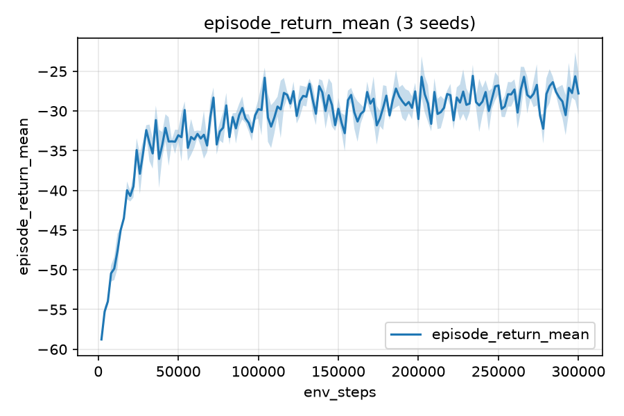
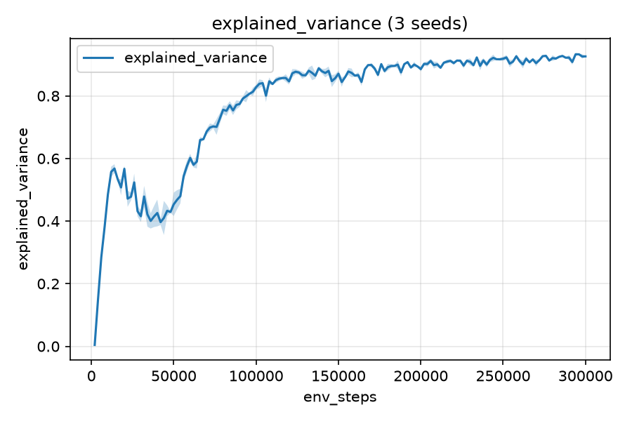

# D-TrOPD — Decentralized Trust-Region Policy Distillation

Implementation of D-TrOPD for networked multi-agent RL, plus baselines and a
pre-registered experiment suite. `SPEC.md` is the authoritative specification;
this README describes only what is built and how to run it.

**Build status: Phases 0–2 complete. Phase 3 (D-TrOPD core) not started.**

| Phase | Scope | State |
|---|---|---|
| 0 | Skeleton: repo structure, configs, seeding, logging, CI-runnable pytest | ✅ |
| 1 | Env + networks + closed-form KL | ✅ |
| 2 | IPPO | ✅ |
| 3 | D-TrOPD core (radius, attenuation, social loss, β warmup) | ⬜ |
| 4 | Baselines (MAPPO, HAPPO, NaiveDistill) | ⬜ |
| 5 | Instrumentation | ⬜ |
| 6 | Experiment harness (rliable figures, paired seeds) | ⬜ |
| 7 | Robustness + scale | ⬜ |

Asking for an unbuilt algorithm fails loudly and names the phase it belongs to,
rather than silently substituting something else.

---

## Install

```bash
python -m venv .venv && source .venv/bin/activate
pip install -r requirements.txt
```

Python 3.10+. Everything runs CPU-only; `train.device=cuda` moves the networks
to a single GPU. No multi-GPU or cluster assumptions anywhere.

Note on PettingZoo: the MPE scenarios were split out of `pettingzoo` at 1.25 and
now live in the `mpe2` package. `mpe2` is used as the *reference implementation*
that our vectorised physics is tested against (`tests/test_env.py::
test_physics_matches_mpe2_world`), not as a runtime dependency of training.

## Quick start

```bash
python run.py --help
python run.py validate --config experiments/configs/ippo_homogeneous.yaml
python run.py smoke                       # 2-agent CPU debug path, < 2 minutes
python run.py train --config experiments/configs/ippo_homogeneous.yaml --seeds 3
python run.py plot --runs runs/phase2/seed0 runs/phase2/seed1 --out figures/curve.png
pytest                                    # full suite, ~2 minutes on CPU
```

Any config value can be overridden from the CLI:

```bash
python run.py train --config experiments/configs/smoke.yaml \
    --set train.total_epochs=20 --set ppo.lr=1e-3
```

## Repository layout

```
dtropd/
  config.py      dataclass configs, validation (incl. κ·η ∈ [1,3]), YAML load
  env.py         cooperative-capture MPE env + heterogeneity zones + stressors
  networks.py    tanh-Gaussian actor, critic, policy_parameters() helper
  buffer.py      rollout storage, GAE (with time-limit bootstrapping)
  kl.py          closed-form Gaussian KL utilities (single source of truth)
  algorithms.py  shared base class + IPPO (D-TrOPD & baselines land later)
  robust.py      trimmed mean, geometric median, Krum
  train.py       training loop, logging, checkpointing, seeding
  evaluate.py    eval rollouts, metrics
  plot.py        figures regenerated from stored metrics
  run.py         CLI entrypoint
  utils.py       seeding, JSONL metrics writer, run metadata, explained variance
tests/           test_kl, test_env, test_invariants, test_attenuation, test_smoke, …
experiments/
  configs/*.yaml
  phase2_acceptance.py
notebooks/D_TrOPD.ipynb
```

## The environment

`dtropd.env.CooperativeCaptureEnv` is a PettingZoo `ParallelEnv`.

* **12 agents, 3 targets.** A target counts as captured on a timestep only when
  **≥ 3 agents are simultaneously within `capture_radius`** of it.
* **Reward**, per timestep, blended by `local_ratio` exactly as PettingZoo
  MPE blends its local and global terms:

  ```
  global   = shaping_weight · Σ_k ( −mean distance of the 3 nearest agents to target k )
           + capture_bonus  · #{captured targets}
           − collision_penalty · #{colliding agent pairs}
  local_i  = − shaping_weight · (distance from agent i to its nearest target)
           − collision_penalty · #{collisions involving agent i}

  r_i = (1 − local_ratio) · global + local_ratio · local_i
  ```

  `local_ratio = 0` gives a pure shared team reward (identical for every
  agent); the default `0.5` matches MPE's default. The capture bonus is always
  global — that is the coordination signal. See "Judgment calls" below.

* **Physics** are exactly PettingZoo MPE's `World.step` (semi-implicit
  integration, damping 0.25, soft-margin contact forces, `dt = 0.1`,
  `sensitivity = 5`), re-implemented in vectorised numpy and checked against a
  live `mpe2` `World` to 1e-9 in the test suite.
* **Actions** are `Box(-1, 1, (2,))` — an (x, y) force command, the natural
  codomain of a tanh-squashed policy.
* **Observations** (49-dim for 12 agents / 3 targets): own velocity and
  position, per-target relative position + visibility flag, per-other-agent
  relative position + visibility flag, two zone flags, and the remaining
  fraction of the episode. Entities beyond the observer's sensor range are
  zeroed and flagged invisible.
* **Heterogeneity zones** (`heterogeneous: true`): a high-friction zone scales
  an agent's velocity to 50% while it is inside, and a masked-observation zone
  shrinks its sensor range from 1.5 to 0.5.
* **Episodes are fixed length** (`max_cycles`): they truncate, never terminate,
  so values are bootstrapped at the horizon.

## Judgment calls

SPEC.md is silent on three points that had to be decided to make Phase 2's
acceptance test meaningful. Each is a config knob, each defaults to the
learnable setting, and each can be reverted in one line.

1. **`env.local_ratio` (default 0.5).** With a purely global team reward, one
   agent out of twelve moves the shared return by ~1/9, and IPPO does not learn
   within any budget we could run: over 60 epochs it stayed at the
   random-policy level. MPE's own `simple_spread` blends a local and a global
   term for exactly this reason, so we blend the same way. `local_ratio: 0.0`
   restores the pure team reward.
2. **Remaining-horizon feature in the observation.** Episodes are fixed length,
   so the return from step *t* depends strongly on how many steps remain.
   Without that feature in the observation the critic cannot predict its own
   target and explained variance is capped near zero no matter how well it is
   trained — which would make invariant I4's "explained variance rising" test
   unpassable for reasons that have nothing to do with the critic.
3. **`ppo.normalize_returns` (default true).** The critic learns
   `(G − μ)/σ` with a running per-agent normaliser and every value it reports
   is de-normalised back into reward units, so advantages, GAE, explained
   variance and (later) the radius signal all see unmodified values. This one
   change moved explained variance from ~0.14 to ~0.87 on the same run.

Points 2 and 3 are optimisation fixes with no algorithmic content. Point 1
changes the task, so it is called out here rather than buried in a default.

## Reproducibility

Every run writes, next to its metrics:

* `metadata.json` — full config, git commit, seed, platform, package versions;
* `metrics.jsonl` — one JSON record per epoch, including per-agent detail;
* `summary.json`, `checkpoint_final.pt`.

All randomness is derived from a single master seed through
`utils.derive_seed(master, *tags)` (BLAKE2b, stable across processes), so a run
is reproducible from `(config, seed)` alone. Minibatch shuffling is driven by a
per-agent, per-epoch generator, so it does not depend on how much randomness
the rest of the update consumed — which is what makes the Phase 3 acceptance
test (β = 0 must reproduce IPPO bitwise) a test of the social path rather than
of RNG bookkeeping.

## Invariants

SPEC Sec. 3 lists nine non-negotiable invariants. `tests/test_invariants.py`
encodes them as executable checks; those that constrain the social path (I1,
I6, I7, I8 and the distillation halves of I3/I5) are present as explicit,
reasoned skips until Phase 3 rather than as an empty file. Enforced today:

* **I2** — one KL direction, no branch: `kl.gaussian_kl` has no `direction`
  argument, a source scan rejects any forward-KL token in the package, and the
  config refuses `kl_direction != "reverse"`.
* **I3** — own-rollout batches: corrupting another agent's buffer slice
  provably leaves this agent's update bit-identical.
* **I4** — critic present and optimised: `value_coef = 0` is a config error,
  critic parameters are asserted to move, explained variance is logged.
* **I5 (improvement half)** — clipping plus KL early stopping; a tiny η is
  shown to halt the inner loop.
* **I9** — `policy_parameters()` excludes the value head; `torch.autograd.grad`
  over the full parameter list is shown to raise, over the helper to succeed.

## Acceptance results

| Phase | Test | Result |
|---|---|---|
| 0 | `pytest` green; `python run.py --help` works | **pass** — 71 passed, 6 skipped (the skips are Phase 3 invariants) |
| 1 | analytic Gaussian KL vs 1e6-sample MC within 1%; env random-policy rollout shapes + reward accounting | **pass** — max relative error 0.10% over three parameter pairs |
| 2 | IPPO on the homogeneous env, 3 seeds, beats random by a clear margin, critic EV > 0.3 | **pass** — see below |

Phase 2 numbers (150 epochs, 12 agents, 3 seeds, ~5 min/seed on one CPU core):

| seed | final return | random return | improvement | margin (random SEMs) | max critic EV | captures/ep (vs random) |
|---|---|---|---|---|---|---|
| 0 | −23.06 | −60.58 | **+37.52** | 17.5 | **0.943** | 35.7 (2.9) |
| 1 | −7.59 | −63.24 | **+55.65** | 21.8 | **0.941** | 59.9 (3.3) |
| 2 | −24.01 | −62.23 | **+38.22** | 10.9 | **0.947** | 34.6 (2.4) |

Mean final return −18.22 vs −62.02 random; mean improvement +43.80.




Regenerate Phase 2:

```bash
python experiments/phase2_acceptance.py --seeds 0 1 2 --workers 3 --out runs/phase2
```

The "clear margin" criterion is operationalised in that script (every seed
must beat the random policy by ≥ 10 standard errors of the random baseline,
every seed must improve, and every seed's critic explained variance must exceed
0.3), and it prints the numbers it judged.
